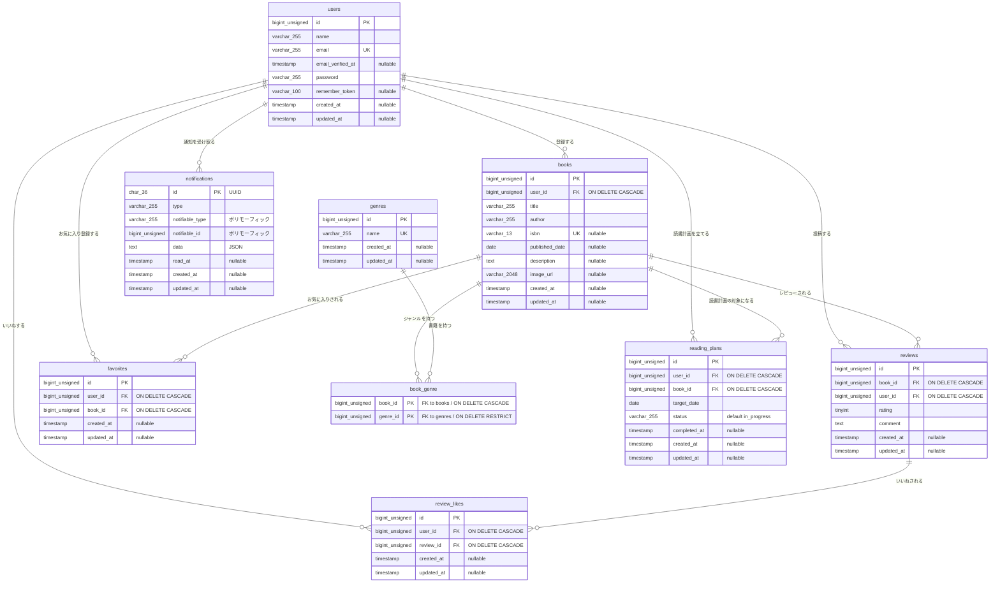

# BookShelf 書籍レビューアプリ

## 概要

BookShelf は、読んだ本を登録してレビューを共有できる書籍レビューアプリです。ユーザーは書籍をジャンル付きで登録し、他のユーザーが投稿したレビューを閲覧・評価しながら、次に読む本を探せます。

Laravel 10 と MySQL 8.4 を Docker（Laravel Sail）上で動かし、画面は Blade + Tailwind CSS、認証は Laravel Fortify で実装しています。あわせて REST API（`/api/v1/books`）を提供し、参照は認証不要・書き込みは Laravel Sanctum のトークン認証で保護しています。

### 実装した機能

#### 基本機能

| 機能         | 概要                                                                                                                             |
| ------------ | -------------------------------------------------------------------------------------------------------------------------------- |
| 認証         | Laravel Fortify による会員登録・ログイン・ログアウト（2要素認証は不使用）                                                        |
| 書籍 CRUD    | 書籍の一覧（10件ページネーション・平均評価の星表示）・詳細・登録・編集・削除。編集と削除は登録者本人のみ（`BookPolicy`）         |
| レビュー     | 書籍へのレビュー投稿（1〜5の評価＋コメント）・編集・削除。同じ書籍へ複数回投稿可能。編集と削除は投稿者本人のみ（`ReviewPolicy`） |
| お気に入り   | 書籍のお気に入り登録・解除をワンクリックで切り替え。お気に入り一覧を10件ページネーションで表示                                   |
| いいね       | レビューへのいいねを切り替え。自分のレビューにもいいね可能                                                                       |
| ジャンル管理 | ジャンルの一覧（書籍数付き）・詳細（所属書籍を10件ページネーション）・登録・編集・削除。書籍が紐付くジャンルは削除不可           |
| ランキング   | レビュー平均評価の高い書籍 TOP 10 を表示（レビュー0件の書籍は除外、同点時はレビュー件数の多い順）                                |

#### 応用機能

| 機能               | 概要                                                                                                                                             |
| ------------------ | ------------------------------------------------------------------------------------------------------------------------------------------------ |
| 高度検索・ソート   | 書籍一覧でキーワード（タイトル・著者の部分一致）とジャンルで絞り込み、登録日（新しい順／古い順）・タイトル昇順・平均評価順（レビュー0件は末尾）で並び替え。条件はページネーションリンクに引き継がれる |
| ISBN 検索          | 書籍の登録・編集フォームで13桁の ISBN から Google Books API を呼び出し、タイトル・著者・出版日・説明・表紙画像URLを自動補完                      |
| マイ読書レポート   | 自分のレビューから基本サマリー（総レビュー数・読了冊数・平均評価）・評価分布・高評価書籍TOP5・ジャンル別評価傾向TOP5を集計して表示                |
| 読書計画           | 書籍ごとに期日を設定して進行中／完了／期限切れを管理。状態での絞り込み、読了操作、期日変更、削除に対応（`ReadingPlanPolicy`）                     |
| リマインダー通知   | 日次バッチが期日の3日前・当日・3日経過後にデータベース通知を送信。ヘッダーの未読バッジと通知一覧から既読化できる                                  |
| 自動失効バッチ     | 日次バッチが期日を過ぎた進行中の読書計画を自動で期限切れに更新                                                                                    |
| 公開 API           | 参照（`GET`）は認証不要、書き込み（`POST` / `PUT` / `DELETE`）は Sanctum トークン認証＋`BookPolicy` による所有者チェック                          |

### 品質

- テスト 277 件（Unit 38 件 / Feature 239 件）、アサーション 827 件、すべて PASS
- テストカバレッジ **95.1%**（全コントローラー・FormRequest・Resource・Policy・Service・Command・Notification・Enum・モデルが 100%）
- `Laravel Pint`（PSR-12 準拠）でエラー 0 件
- 全メソッドに引数・戻り値・リレーションの型宣言と PHPDoc を記述

---

## ER図



### テーブル仕様の補足

| テーブル       | 主キー / 制約                                                                                                                                                                                                 |
| -------------- | ------------------------------------------------------------------------------------------------------------------------------------------------------------------------------------------------------------- |
| `book_genre`   | 複合主キー `(book_id, genre_id)`。`id` カラムと timestamps は持たない。`genre_id` のみ **ON DELETE RESTRICT**（書籍が紐付くジャンルを削除できないようにするため）、他の外部キーはすべて **ON DELETE CASCADE** |
| `reviews`      | `(user_id, book_id)` に複合ユニーク制約は**付けない**（同一ユーザーが同じ書籍へ複数回レビューを投稿できる仕様）                                                                                               |
| `favorites`    | `(user_id, book_id)` に複合ユニーク制約                                                                                                                                                                       |
| `review_likes` | `(user_id, review_id)` に複合ユニーク制約                                                                                                                                                                     |
| `books`        | `isbn` と `published_date` は **nullable**（ISBN・出版日が不明な書籍も登録できる）。`isbn` のユニーク制約は維持（NULL は重複可）                                                                               |
| `reading_plans` | `status` は `App\Enums\ReadingPlanStatus`（`in_progress` / `completed` / `expired`）でキャスト。既定値は `in_progress`                                                                                       |
| `notifications` | `php artisan notifications:table` が生成する Laravel 標準のデータベース通知テーブル。`notifiable_type` / `notifiable_id` のポリモーフィック関連で `users` に紐付く。`data` には `timing` / `title` / `body` / `reading_plan_id` などの JSON を格納 |

---

## 環境構築手順

### 前提

Docker Desktop が起動していること。ホスト側のポート **80 / 3306 / 8080 / 5173** が空いていること。

### 1. リポジトリをクローン

```bash
git clone <このリポジトリのURL> bookshelf-app
cd bookshelf-app
```

### 2. 環境設定ファイルを作成

```bash
cp .env.example .env
```

`.env` は Sail 用の設定（`DB_HOST=mysql` / `DB_DATABASE=laravel` / `DB_USERNAME=sail` / `DB_PASSWORD=password`）が入った状態なので、そのまま使用できます。

ISBN 検索（Google Books API）は **APIキーなしでも動作します**が、キーなしの場合は Google 側のレート制限が厳しく `429`（クォータ超過）が返ることがあります。安定して使う場合は `.env` の `GOOGLE_BOOKS_API_KEY` にキーを設定してください。

```dotenv
GOOGLE_BOOKS_API_KEY=取得したAPIキー
```

### 3. PHP の依存パッケージをインストール

`vendor/` がまだ無い状態では `sail` コマンドが使えないため、公式イメージを使って `composer install` を実行します。

```bash
docker run --rm \
    -u "$(id -u):$(id -g)" \
    -v "$(pwd):/var/www/html" \
    -w /var/www/html \
    laravelsail/php84-composer:latest \
    composer install --ignore-platform-reqs
```

> このステップは依存パッケージの取得のみが目的で、`--ignore-platform-reqs` を付けているためイメージ側の PHP バージョンは問いません。アプリ本体は手順4で `vendor/laravel/sail/runtimes/8.5` からビルドされる **PHP 8.5** のコンテナで動作します。
>
> ローカルに PHP と Composer が入っている場合は、代わりに `composer install` を直接実行しても構いません。

### 4. Docker コンテナを起動

```bash
./vendor/bin/sail up -d
```

初回はイメージのビルドに数分かかります。`./vendor/bin/sail ps` で `laravel.test` / `mysql` / `phpmyadmin` の3コンテナが `Up` になるのを確認してください。

### 5. アプリケーションキーを生成

```bash
./vendor/bin/sail artisan key:generate
```

### 6. データベースの作成とシーディング

```bash
./vendor/bin/sail artisan migrate --seed
```

初期データとして ユーザー5件 / ジャンル10件 / 書籍11件 / レビュー22〜44件 / お気に入り21件 / いいね / 読書計画6件 が投入されます。

- 書籍の登録者は5ユーザーからランダムに割り当てられます。
- レビューは各書籍に 2〜4 件をランダムなユーザー（書籍内で重複なし）で作成し、評価は 1〜5 の全範囲から選ばれます。そのため実行ごとに件数が変動します。
- 読書計画6件は `Carbon::today()` 起点で作成され、日次バッチの動作確認に必要なパターン（期日3日前・当日・3日経過・1週間後・完了済み・別ユーザー）を網羅します。

> すでにテーブルがある状態でやり直す場合は `./vendor/bin/sail artisan migrate:fresh --seed` を使用してください。

### 7. フロントエンドのビルド

画面は Vite でビルドした CSS / JS を読み込むため、このステップは**必須**です（未実行だと画面表示時にエラーになります）。

```bash
./vendor/bin/sail npm install
./vendor/bin/sail npm run build
```

開発中にホットリロードを使う場合は、ビルドの代わりに `./vendor/bin/sail npm run dev` を実行したままにしてください。

### 8. 動作確認

ブラウザで http://localhost を開くと書籍一覧が表示されます。

### テスト用ログインアカウント

シーディングで作成される5アカウントはすべてパスワードが `password` です。

| 名前     | メールアドレス          | パスワード |
| -------- | ----------------------- | ---------- |
| 山田太郎 | `yamada@example.com`    | `password` |
| 鈴木花子 | `suzuki@example.com`    | `password` |
| 田中一郎 | `tanaka@example.com`    | `password` |
| 佐藤美咲 | `sato@example.com`      | `password` |
| 高橋健太 | `takahashi@example.com` | `password` |

書籍の登録者はシーディング時にランダムに割り当てられます。書籍の編集・削除は登録者本人のみ可能なため、他アカウントでアクセスすると 403 になります（これは仕様どおりの挙動です）。自分が登録者である書籍は、書籍詳細画面に「編集」「削除」ボタンが表示されているかどうかで判別できます。

読書計画は **山田太郎**（5件）と **鈴木花子**（1件）に投入されるため、読書計画・通知・マイレポートを確認する場合は `yamada@example.com` でログインしてください。

### テストの実行方法

テストは `phpunit.xml` の設定により MySQL 上の **`testing` データベース**を使用します。開発用の `laravel` データベースのシードデータは破壊されません。

```bash
# 全テストを実行（277件）
./vendor/bin/sail artisan test

# カバレッジ付きで実行
./vendor/bin/sail artisan test --coverage

# 特定のテストのみ実行
./vendor/bin/sail artisan test --filter=PublicApiTest
./vendor/bin/sail artisan test --testsuite=Unit
```

#### テストカテゴリ一覧

| テストファイル                       | 件数 | 対象                                                                   |
| ------------------------------------ | ---- | ---------------------------------------------------------------------- |
| `Feature/AuthTest`                   | 15   | 会員登録・ログイン・ログアウト                                         |
| `Feature/BookCrudTest`               | 24   | 書籍 CRUD・認可・任意項目（`isbn` / `published_date`）                  |
| `Feature/BookSearchTest`             | 16   | キーワード検索・ジャンル絞り込み・ソート・ページネーション条件引き継ぎ |
| `Feature/IsbnSearchTest`             | 11   | ISBN 検索（`Http::fake()` で 200 / 400 / 404 / 429 / 500 を網羅）      |
| `Feature/ReportTest`                 | 12   | マイ読書レポートの4種の統計・他ユーザーデータの非混入                  |
| `Feature/PublicApiTest`              | 41   | 公開 API（AP01〜AP05）と Sanctum 認証（AP06：401 / 403 / 所有者成功）  |
| `Feature/ReadingPlanTest`            | 29   | 読書計画の一覧・絞り込み・作成・重複・更新・完了・削除・認可           |
| `Feature/NotificationTest`           | 10   | 通知一覧・既読化・他ユーザー通知の 404                                 |
| `Feature/RunDailyReadingPlanTasksTest` | 12 | 自動失効・リマインダー通知3種・スケジュール登録                        |
| `Feature/GenreTest`                  | 16   | ジャンル管理                                                           |
| `Feature/ReviewTest`                 | 15   | レビュー CRUD・認可                                                    |
| `Feature/FavoriteTest`               | 9    | お気に入り                                                             |
| `Feature/RankingTest`                | 8    | 評価ランキング                                                         |
| `Feature/PageAccessTest`             | 9    | 各画面のアクセス制御                                                   |
| `Feature/ReviewLikeTest`             | 6    | レビューのいいね                                                       |
| `Unit/Models/*`                      | 38   | 各モデルのリレーション・キャスト・`fillable`・カスケード削除           |

`testing` データベースは Sail の初期化スクリプトが自動作成します。万一存在しない場合は次のコマンドで作成してください。

```bash
./vendor/bin/sail mysql -e "CREATE DATABASE IF NOT EXISTS testing;"
```

### コードフォーマット

```bash
# 整形を実行
./vendor/bin/sail bin pint

# 差分チェックのみ（CI 用）
./vendor/bin/sail bin pint --test
```

---

## 使用技術

### バックエンド

| 技術              | バージョン          |
| ----------------- | ------------------- |
| PHP               | 8.5.8               |
| Laravel Framework | 10.50.4（`^10.10`） |
| MySQL             | 8.4.11              |
| Laravel Fortify   | `^1.36`（認証）     |
| Laravel Sanctum   | `^3.3`（API トークン認証） |
| Laravel Tinker    | `^2.8`              |

### フロントエンド

| 技術                | バージョン      |
| ------------------- | --------------- |
| Blade               | Laravel 10 標準 |
| Tailwind CSS        | `^3.4.19`       |
| @tailwindcss/forms  | `^0.5.11`       |
| Alpine.js           | `^3.17.5`       |
| Vite                | `^5.0.0`        |
| laravel-vite-plugin | `^1.0.0`        |
| Axios               | `^1.6.4`        |

### 開発環境・品質管理

| 技術                  | バージョン       |
| --------------------- | ---------------- |
| Docker / Laravel Sail | `^1.69`          |
| phpMyAdmin            | latest           |
| PHPUnit               | `^10.1`          |
| Laravel Pint          | `^1.0`（PSR-12） |

### 設計方針

- DB 操作は Eloquent ORM を使用し、N+1 問題対策として `with()` / `withCount()` / `withAvg()` を活用
- バリデーションは `FormRequest` に分離し、全クラスで `messages()` に日本語メッセージを定義
- 認可は `Policy` に分離し、コントローラーで `$this->authorize()` を呼び出し
- API のレスポンス整形は API Resource（`BookResource` / `GenreResource` / `ReviewResource`）に分離
- エラーメッセージは `lang/ja/` の言語ファイルで日本語化（`config/app.php` の `locale` は `ja`）
- 状態値は PHP の Enum（`ReadingPlanStatus` / `ReminderTiming`）で型安全に扱い、表示ラベルとバッジのCSSクラスも Enum に集約
- マイ読書レポートの集計は手続き的なループを使わず、Collection メソッド（`countBy` / `groupBy` / `flatMap` / `map` / `filter` / `sortByDesc` / `take`）で宣言的に記述し、`ReportService` に分離
- 通知は Laravel のデータベース通知（`ReadingPlanReminderNotification`）、定期実行は Artisan コマンド＋`app/Console/Kernel.php` のスケジューラで実装
- 外部 API 連携は `Illuminate\Support\Facades\Http` を使用し、APIキーは `config/services.php` 経由で参照（設定キャッシュに対応）
- 全メソッドに引数・戻り値・リレーションの型宣言と PHPDoc を記述

---

## APIエンドポイント一覧

ベース URL は `http://localhost/api/v1` です。**参照系は認証不要**、**書き込み系は Laravel Sanctum のトークン認証が必須**です。

| #    | メソッド | パス                   | 認証                | 概要                                                               |
| ---- | -------- | ---------------------- | ------------------- | ------------------------------------------------------------------ |
| AP01 | `GET`    | `/api/v1/books`        | 不要                | 書籍一覧。キーワード検索・ジャンル絞り込み・ページネーションに対応 |
| AP02 | `GET`    | `/api/v1/books/{book}` | 不要                | 書籍詳細。ジャンルとレビュー（投稿者名付き）を含む                 |
| AP03 | `POST`   | `/api/v1/books`        | **必要**            | 書籍を登録（201 Created）。登録者は常にトークンの所有者            |
| AP04 | `PUT`    | `/api/v1/books/{book}` | **必要**（登録者） | 書籍を更新（200 OK）                                               |
| AP05 | `DELETE` | `/api/v1/books/{book}` | **必要**（登録者） | 書籍を削除（204 No Content）                                       |
| AP06 | —        | —                      | —                   | 上記の認証・認可仕様（トークンの発行方法と 401 / 403 の挙動）      |

### 共通仕様

- リクエストボディは JSON（`Content-Type: application/json`）とフォーム形式の両方に対応
- `Accept: application/json` ヘッダーが無い場合でも、`api/*` へのリクエストは常に JSON で応答します
- バリデーションエラーは **422 Unprocessable Content**、`message` と `errors` を含む JSON を返します
- 存在しない書籍 ID を指定した場合は **404 Not Found** で `{"error": "書籍が見つかりませんでした。"}` を返します
- 書き込み系でトークンが無い／無効な場合は **401 Unauthorized** で `{"message": "Unauthenticated."}` を返します
- 他ユーザーが登録した書籍を更新・削除しようとした場合は **403 Forbidden** で `{"error": "この操作を実行する権限がありません。"}` を返します
- 1分あたり60リクエストのレート制限（`throttle:api`）が適用されます

---

### AP01 `GET /api/v1/books`

書籍一覧を取得します。

**クエリパラメータ**

| パラメータ | 型      | 必須 | 説明                                                             |
| ---------- | ------- | ---- | ---------------------------------------------------------------- |
| `keyword`  | string  | 任意 | タイトルまたは著者の部分一致検索（最大255文字）                  |
| `genre_id` | integer | 任意 | 指定したジャンルを持つ書籍に絞り込み（`genres.id` に存在する値） |
| `page`     | integer | 任意 | ページ番号（1以上）。既定値 1                                    |
| `per_page` | integer | 任意 | 1ページあたりの件数（1〜100）。既定値 20                         |

**リクエスト例**

```bash
# 全件取得
curl "http://localhost/api/v1/books"

# 「夏目」でキーワード検索（タイトル・著者の部分一致）
curl -G "http://localhost/api/v1/books" --data-urlencode "keyword=夏目"

# ジャンルID 3（技術書）で絞り込み、1ページ5件
curl "http://localhost/api/v1/books?genre_id=3&per_page=5&page=1"
```

> キーワードに日本語を使う場合は `--data-urlencode` などで URL エンコードしてください。

**レスポンス例（200 OK）**

```json
{
    "data": [
        {
            "id": 1,
            "user_id": 1,
            "title": "吾輩は猫である",
            "author": "夏目漱石",
            "isbn": "9784101010014",
            "published_date": "1905-01-01",
            "description": "中学校の英語教師である苦沙弥先生の家に住む猫の視点から、明治の知識人たちの滑稽な日常を描いた長編小説。風刺とユーモアに満ちた文体が魅力です。",
            "image_url": "https://placehold.co/300x400?text=1",
            "genres": [{ "id": 1, "name": "小説" }],
            "average_rating": 4,
            "reviews_count": 4,
            "created_at": "2026-11-15T06:43:32.000000Z",
            "updated_at": "2026-11-15T06:43:32.000000Z"
        }
    ],
    "links": {
        "first": "http://localhost/api/v1/books?page=1",
        "last": "http://localhost/api/v1/books?page=1",
        "prev": null,
        "next": null
    },
    "meta": {
        "current_page": 1,
        "last_page": 1,
        "per_page": 20,
        "total": 11
    }
}
```

- `average_rating` はレビュー平均評価（小数2桁に丸め）。レビューが0件の場合は `null`
- 一覧では `reviews` 配列は含まれません（詳細 API のみ）
- `meta` には上記のほか `from` / `to` / `path` / `links` も含まれます（Laravel 標準のページネーション形式）

**エラー例（422 Unprocessable Content）**

```json
{
    "message": "1ページあたりの件数は100以下で指定してください。",
    "errors": {
        "per_page": ["1ページあたりの件数は100以下で指定してください。"]
    }
}
```

---

### AP02 `GET /api/v1/books/{book}`

書籍詳細を取得します。ジャンルとレビュー（投稿者名・評価・コメント）を含みます。

**リクエスト例**

```bash
curl "http://localhost/api/v1/books/3"
```

**レスポンス例（200 OK）**

```json
{
    "data": {
        "id": 3,
        "user_id": 1,
        "title": "リーダブルコード",
        "author": "Dustin Boswell",
        "isbn": "9784873115658",
        "published_date": "2012-06-23",
        "description": "読みやすいコードを書くための具体的なテクニックを解説した一冊。命名、コメント、制御フローの改善など、実務で即座に使える知見が詰まっています。",
        "image_url": "https://placehold.co/300x400?text=3",
        "genres": [{ "id": 3, "name": "技術書" }],
        "average_rating": 4.5,
        "reviews_count": 4,
        "reviews": [
            {
                "id": 8,
                "user_name": "山田太郎",
                "rating": 5,
                "comment": "命名とコメントの章だけでも読む価値があります。チームの新人全員に配りたい一冊です。",
                "created_at": "2026-11-15T06:43:32.000000Z"
            }
        ],
        "created_at": "2026-11-15T06:43:32.000000Z",
        "updated_at": "2026-11-15T06:43:32.000000Z"
    }
}
```

**エラー例（404 Not Found）**

```json
{
    "error": "書籍が見つかりませんでした。"
}
```

---

### AP03 `POST /api/v1/books`

書籍を登録します。**Sanctum トークンが必須**で、登録者（`user_id`）は常にトークンの所有者になります（リクエストボディで指定することはできません）。

**リクエストボディ**

| パラメータ       | 型      | 必須     | 説明                                                           |
| ---------------- | ------- | -------- | -------------------------------------------------------------- |
| `title`          | string  | **必須** | タイトル（最大255文字）                                        |
| `author`         | string  | **必須** | 著者（最大255文字）                                            |
| `isbn`           | string  | **必須** | 13桁の数字。`books.isbn` で一意                                |
| `published_date` | date    | **必須** | 出版日（例 `2026-11-15`）                                      |
| `description`    | string  | 任意     | 説明                                                           |
| `image_url`      | string  | 任意     | 画像URL（URL形式・最大2048文字）                               |
| `genres`         | array   | **必須** | ジャンルIDの配列（1つ以上、各要素は `genres.id` に存在する値） |

**リクエスト例**

```bash
curl -X POST "http://localhost/api/v1/books" \
  -H "Content-Type: application/json" \
  -H "Authorization: Bearer $TOKEN" \
  -d '{
    "title": "新しい書籍",
    "author": "著者名",
    "isbn": "9781234567897",
    "published_date": "2026-11-15",
    "description": "書籍の説明です。",
    "image_url": "https://placehold.co/300x400?text=new",
    "genres": [1, 3]
  }'
```

**レスポンス例（201 Created）**

```json
{
    "data": {
        "id": 12,
        "user_id": 1,
        "title": "新しい書籍",
        "author": "著者名",
        "isbn": "9781234567897",
        "published_date": "2026-11-15",
        "description": "書籍の説明です。",
        "image_url": "https://placehold.co/300x400?text=new",
        "genres": [
            { "id": 1, "name": "小説" },
            { "id": 3, "name": "技術書" }
        ],
        "average_rating": null,
        "reviews_count": 0,
        "created_at": "2026-11-15T07:10:00.000000Z",
        "updated_at": "2026-11-15T07:10:00.000000Z"
    }
}
```

**エラー例（422 Unprocessable Content）**

```json
{
    "message": "タイトルを入力してください。 (and 2 more errors)",
    "errors": {
        "title": ["タイトルを入力してください。"],
        "isbn": ["ISBNは13桁の数字で入力してください。"],
        "genres": ["ジャンルを1つ以上指定してください。"]
    }
}
```

> 公開 API では `isbn` と `published_date` は **必須**です（Web 画面側のみ任意項目）。

**エラー例（401 Unauthorized）**

```json
{
    "message": "Unauthenticated."
}
```

---

### AP04 `PUT /api/v1/books/{book}`

書籍を更新します。リクエストボディは AP03 と同じです。**Sanctum トークンが必須**で、`BookPolicy` により**登録者本人のみ**更新できます。登録者（`user_id`）は更新対象ではないため変更されません。`isbn` の一意性チェックは更新対象のレコード自身を除外するため、ISBN を変更せずに更新できます。

**リクエスト例**

```bash
curl -X PUT "http://localhost/api/v1/books/12" \
  -H "Content-Type: application/json" \
  -H "Authorization: Bearer $TOKEN" \
  -d '{
    "title": "更新後のタイトル",
    "author": "更新後の著者",
    "isbn": "9781234567897",
    "published_date": "2026-11-16",
    "description": "更新後の説明です。",
    "image_url": "https://placehold.co/300x400?text=upd",
    "genres": [6]
  }'
```

**レスポンス例（200 OK）**

```json
{
    "data": {
        "id": 12,
        "user_id": 1,
        "title": "更新後のタイトル",
        "author": "更新後の著者",
        "isbn": "9781234567897",
        "published_date": "2026-11-16",
        "description": "更新後の説明です。",
        "image_url": "https://placehold.co/300x400?text=upd",
        "genres": [{ "id": 6, "name": "歴史" }],
        "average_rating": null,
        "reviews_count": 0,
        "created_at": "2026-11-15T07:10:00.000000Z",
        "updated_at": "2026-11-15T07:12:00.000000Z"
    }
}
```

ジャンルは `sync()` で同期されるため、リクエストに含まれないジャンルの紐付けは解除されます。

**エラー例（403 Forbidden）**

他ユーザーが登録した書籍を更新しようとした場合。

```json
{
    "error": "この操作を実行する権限がありません。"
}
```

**エラー例（404 Not Found）**

```json
{
    "error": "書籍が見つかりませんでした。"
}
```

---

### AP05 `DELETE /api/v1/books/{book}`

書籍を削除します。**Sanctum トークンが必須**で、`BookPolicy` により**登録者本人のみ**削除できます。外部キーの `ON DELETE CASCADE` により、紐付くジャンル（`book_genre`）・レビュー・お気に入り・レビューのいいね・読書計画も同時に削除されます。

**リクエスト例**

```bash
curl -X DELETE "http://localhost/api/v1/books/12" -i \
  -H "Authorization: Bearer $TOKEN"
```

**レスポンス（204 No Content）**

レスポンスボディはありません。

```
HTTP/1.1 204 No Content
```

**エラー例（403 Forbidden）**

```json
{
    "error": "この操作を実行する権限がありません。"
}
```

**エラー例（404 Not Found）**

```json
{
    "error": "書籍が見つかりませんでした。"
}
```

---

### AP06 Sanctum トークン認証

書き込み系（AP03 / AP04 / AP05）は `auth:sanctum` ミドルウェアで保護されています。

**トークンの発行**

```bash
./vendor/bin/sail artisan tinker --execute="echo App\Models\User::where('email','yamada@example.com')->firstOrFail()->createToken('api-test')->plainTextToken;"
```

出力された文字列（`1|xxxxxxxx...` 形式）を `Authorization` ヘッダーに付与します。

```bash
TOKEN="発行されたトークン"

curl "http://localhost/api/v1/books" \
  -H "Authorization: Bearer $TOKEN"
```

**認証・認可の挙動**

| ケース                                     | ステータス | レスポンス                                           |
| ------------------------------------------ | ---------- | ---------------------------------------------------- |
| `GET`（トークンなし）                      | `200`      | 参照系は認証不要                                     |
| `POST` / `PUT` / `DELETE`（トークンなし）  | `401`      | `{"message": "Unauthenticated."}`                    |
| `POST`（トークンあり）                     | `201`      | 登録者はトークンの所有者になる                       |
| `PUT` / `DELETE`（登録者本人のトークン）   | `200` / `204` | 成功                                              |
| `PUT` / `DELETE`（他ユーザーのトークン）   | `403`      | `{"error": "この操作を実行する権限がありません。"}`  |

**トークンの失効**

```bash
./vendor/bin/sail artisan tinker --execute="App\Models\User::where('email','yamada@example.com')->firstOrFail()->tokens()->delete();"
```

---

## 日次バッチ処理

読書計画の自動失効とリマインダー通知を行う Artisan コマンドを用意しています。

### コマンド

```bash
./vendor/bin/sail artisan reading-plans:run-daily
```

### 処理内容

実行順序には意味があります。失効処理を先に行うことで、期日から3日経過した計画が同じ実行内で「期日経過」通知の対象になります。

| 順 | 処理                 | 対象                                                              | 結果                                      |
| -- | -------------------- | ----------------------------------------------------------------- | ----------------------------------------- |
| 1  | 自動失効             | `in_progress` かつ 期日 < 本日                                    | `expired` に更新                          |
| 2  | 3日前リマインダー    | `in_progress` かつ 期日 == 本日 + 3日                             | `three_days_before` の通知を送信          |
| 3  | 当日リマインダー     | `in_progress` かつ 期日 == 本日                                   | `on_due_date` の通知を送信                |
| 4  | 期日経過リマインダー | `expired` かつ 期日 == 本日 − 3日                                 | `three_days_after` の通知を送信           |

### 実行例

```
$ ./vendor/bin/sail artisan reading-plans:run-daily
期限切れに更新した読書計画: 1件
three_days_before の通知を送信: 1件
on_due_date の通知を送信: 1件
three_days_after の通知を送信: 1件
```

通知は `notifications` テーブルに保存され、ヘッダーのベルアイコンの未読バッジと通知一覧（http://localhost/notifications ）に反映されます。

### スケジュール実行

`app/Console/Kernel.php` で**毎日 20:00** に実行するよう登録しています。

```php
$schedule->command('reading-plans:run-daily')->daily()->at('20:00');
```

登録内容は次のコマンドで確認できます。

```bash
./vendor/bin/sail artisan schedule:list
```

スケジューラを実際に動かすには、ホスト側の cron から1分ごとに `schedule:run` を実行します（開発中は `schedule:work` で代用できます）。

```bash
# 開発用（フォアグラウンドで常駐し、登録時刻になるとコマンドを実行する）
./vendor/bin/sail artisan schedule:work

# 本番用（ホストの crontab に登録）
* * * * * cd /path/to/bookshelf-app && ./vendor/bin/sail artisan schedule:run >> /dev/null 2>&1
```

> 日次バッチは冪等ではありません。同じ日に複数回実行すると同じ通知が重複して作成されます（1日1回のスケジュール実行を前提とした設計です）。

---

## 開発環境URL

| 用途                 | URL                           | 備考                                                                                                               |
| -------------------- | ----------------------------- | ------------------------------------------------------------------------------------------------------------------ |
| トップ / 書籍一覧    | http://localhost              | `/` と `/books` の両方で書籍一覧を表示                                                                             |
| 公開 API（書籍一覧） | http://localhost/api/v1/books | 参照は認証不要。書き込みは Sanctum トークンが必要                                                                 |
| phpMyAdmin           | http://localhost:8080         | `compose.yaml` の `FORWARD_PHPMYADMIN_PORT`（既定 `8080`）。ユーザー `sail` / パスワード `password` で自動ログイン |
| Vite 開発サーバー    | http://localhost:5173         | `sail npm run dev` 実行時のみ                                                                                      |

### 画面一覧

| 画面           | URL                           | 認証                       |
| -------------- | ----------------------------- | -------------------------- |
| 書籍一覧       | http://localhost/books        | 不要                       |
| 書籍詳細       | http://localhost/books/1      | 不要                       |
| 評価ランキング | http://localhost/ranking      | 不要                       |
| ログイン       | http://localhost/login        | 不要                       |
| 会員登録       | http://localhost/register     | 不要                       |
| 書籍登録       | http://localhost/books/create | **必要**                   |
| 書籍編集       | http://localhost/books/1/edit | **必要**（登録者本人のみ） |
| お気に入り一覧 | http://localhost/favorites    | **必要**                   |
| ジャンル管理   | http://localhost/genres       | **必要**                   |
| ジャンル詳細   | http://localhost/genres/1     | **必要**                   |
| マイ読書レポート | http://localhost/reports    | **必要**                   |
| 読書計画一覧   | http://localhost/reading-plans | **必要**（自分の計画のみ） |
| 読書計画作成   | http://localhost/reading-plans/create | **必要**           |
| 読書計画編集   | http://localhost/reading-plans/1/edit | **必要**（所有者本人・未完了のみ） |
| 通知一覧       | http://localhost/notifications | **必要**（自分の通知のみ） |

書籍一覧（http://localhost/books ）では、クエリパラメータで検索・絞り込み・並び替えができます。

| URL 例                                      | 内容                                     |
| ------------------------------------------- | ---------------------------------------- |
| `/books?keyword=漱石`                       | タイトル・著者の部分一致検索             |
| `/books?genre=3`                            | ジャンルID 3 で絞り込み                  |
| `/books?sort=rating`                        | 平均評価の高い順（レビュー0件は末尾）    |
| `/books?keyword=コード&genre=3&sort=title`  | 併用（条件はページ送りでも維持される）   |

ISBN 検索は書籍登録・編集画面のフォームから利用します（内部エンドポイントは `GET /books/isbn/{isbn}`・認証必須）。

### ポート変更

ホスト側のポートが使用中の場合は `.env` に以下を追記して `./vendor/bin/sail up -d` を再実行してください。

```dotenv
APP_PORT=8000
FORWARD_DB_PORT=33060
FORWARD_PHPMYADMIN_PORT=8081
VITE_PORT=5174
```

## 作成者

川村樹里
